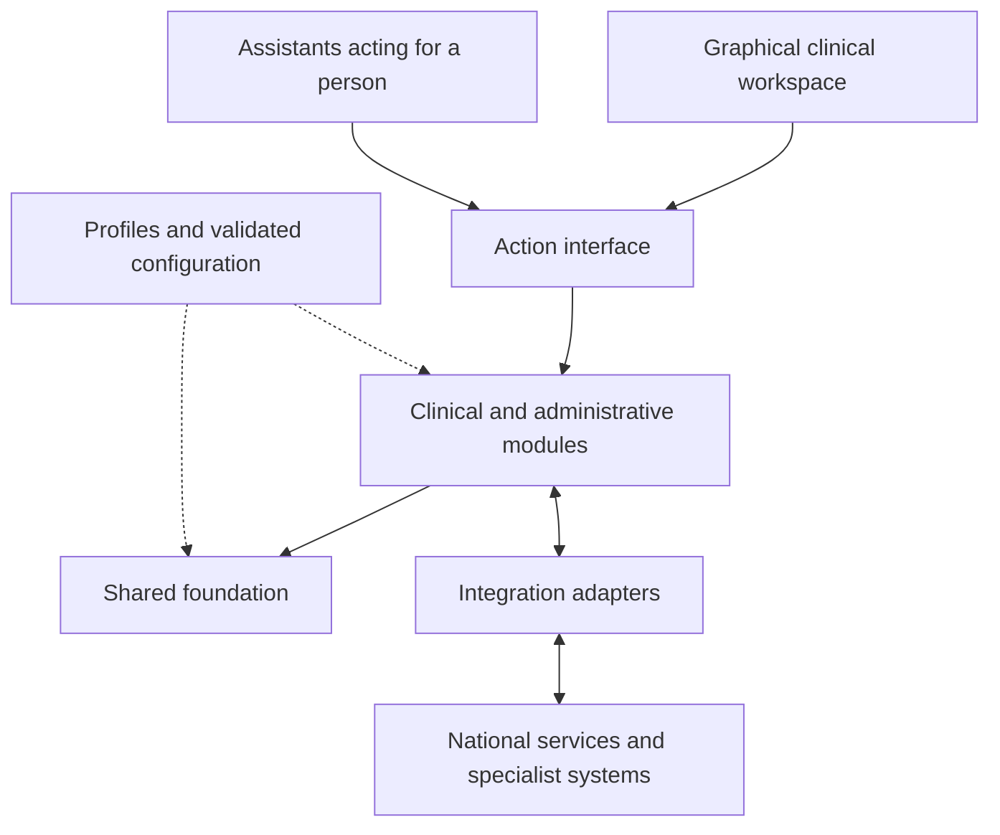

# Foundational design exploration

[Master specification](../SPECIFICATION.md) · **Status:** Exploratory proposal · **Date:** 2026-09-19

Recommendations for discussion, not adopted architecture or additional requirements. Existing requirement statements remain authoritative. Adoption would update the linked decisions and affected requirements with verification criteria.

## Shared foundation and domain ownership

**Recommendation:** Share the concepts and guarantees needed across care settings; give each clinical or administrative domain an explicit owner for its information and behavior.

| Shared responsibility | Proposed boundary |
|---|---|
| Identity and relationships | Stable internal identities; external identifiers with scheme and issuer; patient matching and correction; professional, representative, and organization relationships. Matching does not itself grant access. |
| Care context | Providers, units, teams, contacts, episodes, and responsibility over time. Concurrent care is supported; an encounter is not required for every piece of longitudinal information. |
| Clinical information contracts | Common identity, version, provenance, time, terminology, and reference conventions. Domain owners define typed clinical content and its valid changes. |
| Access and accountability | Shared policy enforcement, consent/restriction inputs, exceptional-access handling, and audit. Organization hierarchy and security boundaries are distinct concepts. |
| Work coordination | Assignment, queues, deadlines, handover, and escalation. Domain owners determine when clinical work is complete. |
| Configuration and compatibility | Module dependencies, versioned profiles, terminology/template definitions, validation, and effective configuration history. |

Candidate domains include documentation, clinical observations and problems, medication, diagnostics, referrals, care planning, scheduling and capacity, patient participation, and finance. These are responsibility boundaries to test against workflows, not final packages. The [coverage map](coverage.md) retains the wider ambition.

Each authoritative item has one logical write owner. Other modules request changes through that owner's contract. The shared chart composes authorized views of domain information; documents can reference exact versions of structured items rather than create competing authoritative copies. Imported information retains its external source authority.

Modules contribute to a common workspace with consistent patient context, navigation, work lists, and history. Optional modules declare dependencies on shared clinical capabilities, such as allergy information used by medication workflows.

This shows logical responsibilities, not process or deployment boundaries. The action interface is [adopted direction](../SPECIFICATION.md#interaction-surfaces); the rest of this diagram remains a proposal.

## Clinical information over time

**Recommendation:** Represent clinical information as attributed, versioned statements with domain-specific meaning. Keep these distinctions explicit:

| Distinction | Example |
|---|---|
| Item identity and revision | A correction creates a new revision of the same result; references to the earlier revision still resolve. |
| Clinical time and recording time | A measurement taken yesterday can be recorded today without changing when it occurred. Unknown or approximate times remain explicit. |
| Source and clinical assessment | Patient-reported information can later be confirmed; its origin remains patient-reported. |
| Clinical state and recording state | A condition can be resolved while its record remains valid. An entry made in error has a different meaning. |
| Evidence and selected interpretation | Conflicting sources remain traceable; reconciliation records the responsible person's assessment and rationale. |
| Stored content and derived view | A summary identifies source revisions and freshness. Missing or delayed data does not imply a negative clinical finding. |

For signed documentation, preserve the reviewed presentation and bind confirmation to its defined content scope, exact revisions, and relevant configuration. Check required freshness atomically; a conflicting change requires renewed review. An amendment creates a linked revision; an earlier signature continues to describe the earlier content. Retention and authorized disposal remain separate governed operations.

For example: a clinician reviews revision 4 while a colleague creates revision 5. Signing revision 4 as the current document fails visibly. Reviewing and signing revision 5 succeeds; later correction produces revision 6 with the history intact. The precise signing unit and rules remain open under [DOC-Q01](clinical-requirements.md#clinical-documentation) and [INF-Q02](clinical-requirements.md#information-requirements).

This concurrency approach has a standards precedent in FHIR R5's version-aware updates, which reject a mismatched `If-Match` version. It does not select our storage model. [HL7 FHIR R5 REST API, managing contention](https://hl7.org/fhir/R5/http.html#concurrency).

## Requests, work, and outcomes

**Recommendation:** Give each domain its own clinical lifecycle, linked to shared coordination.

| Concept | Diagnostic example |
|---|---|
| Request | Investigation requested, amended, or cancelled. |
| Fulfilment work | Collection and analysis assigned, accepted, underway, or blocked. |
| Recorded outcome | Preliminary, final, or corrected result. |
| Review and follow-up | A responsible recipient reviews the result and records the required follow-up. |

Receiving a result does not complete review. Cancelling a request does not erase work already performed. A task changes clinical state only through the owning domain's validated operation. A handover retains an accountable owner until a receiving owner accepts or a defined fallback takes responsibility.

HL7 distinguishes requests, events, and definitions and supports tasks for fulfilment. This supports the conceptual separation; our lifecycle rules still need definition. [FHIR R5 workflow](https://hl7.org/fhir/R5/workflow.html), [FHIR R5 Task](https://hl7.org/fhir/R5/task.html).

Within one transaction boundary, persist the necessary state changes, audit evidence, and pending integration work atomically before reporting success. Across repositories, use durable operation tracking and reconciliation with explicit intermediate states; a single application does not guarantee a shared transaction. External delivery has separate pending, acknowledged, and failed states. Retries carry a stable operation identity; duplicates are reconciled, and an unknown delivery outcome remains visible. Required freshness is checked before consequential actions; background summaries and notifications can update later where the workflow permits.

## Configuration, access, and extension

**Recommendation:** Profiles contribute explicit constraints. Organization settings choose within permitted bounds. Conflicting obligations make the combination invalid pending resolution; there is no universal last-setting-wins rule.

Templates can arrange content and bind terminology while preserving the content model's meaning. A changed clinical meaning or transition rule needs a versioned extension and compatibility checks. Historical records retain the definitions needed to interpret them. Disabling a module requires disposition of pending work and continued authorized history access through a compatible reader or migration.

Access decisions consider the actor, action, patient, organizational scope, care relationship, purpose, and current restrictions. Apply them to APIs, searches, exports, summaries, and background work. Permission changes affect cached views and queued deliveries; historical policy is evidence, not permission to disclose today. Restricted source content cannot leak through derived summaries or counts.

## Implementation shape and unresolved choices

**Recommendation:** Start with one deployable application containing enforced modules, with module-owned persistence and explicit contracts. This keeps installation and local transactions manageable while we test domain boundaries. Contract checks prevent direct access to another module's private storage. Separate services become justified by concrete isolation, scaling, or lifecycle needs.

This assumes trusted modules shipped through the project release process. Untrusted extensions would need a separate execution and permission design. The [development approach](../SPECIFICATION.md#development-approach) adopts C# for the backend and PostgreSQL as the database. Frameworks and physical storage boundaries remain undecided.

The [record model comparison](record-model-comparison.md) walks through concurrent signing, corrected results, and cross-setting handover. It recommends an openEHR-based clinical-content prototype with product-owned workflow behavior and FHIR exchange, compared against a FHIR-native implementation. The preference is provisional. An [EHRbase repository probe](prototype-findings.md) provides limited runtime evidence, including original concurrency failures and a verified local patch; the clinical cases remain unverified.

Candidates assessed:

| Candidate | What to investigate |
|---|---|
| FHIR resources as the internal record model | Fit to our workflows, version/signature scope, profiles, extensions, and domain-operation enforcement. |
| openEHR for clinical content, with domain workflow modules | Archetype/template authoring, querying, versioned content, integration mappings, and operation of the repository. |
| Product-owned typed domain models with standard mappings | Model maintenance, interoperability fidelity, migration, and the cost of owning clinical definitions. |

openEHR separates its reference model, clinical archetypes, and context-specific templates, and defines versioned content and changesets. Those are relevant capabilities to evaluate, not evidence that it is the best fit here. [openEHR BASE 1.2.0 architecture, sections 4.1.1 and 8](https://specifications.openehr.org/releases/BASE/Release-1.2.0/architecture_overview.html).

Three other choices materially affect the foundation: organizational isolation and permitted cross-provider sharing; offline reads versus offline clinical writes and reconciliation; and extension trust. A single shared identity store or universal multi-provider chart is not assumed.

## Scenarios to challenge the proposal

These are planned design checks, not executed tests or new release commitments.

| Scenario | Expected evidence |
|---|---|
| Concurrent amendment and signing | No silent overwrite or signature on unreviewed content. |
| Corrected result after review | Prior result and review retained; responsible follow-up reopened or explicitly reassessed. |
| External timeout followed by retry | No uncontrolled duplicate action; uncertain delivery and reconciliation visible. |
| Wrong patient merge discovered later | Source associations remain traceable; subsequent work is reconciled through an explicit correction process. |
| Access revoked with a cached summary or queued export | Current restrictions prevent disclosure, including derived content. |
| Module removed during an active care plan | Activation blocked until dependencies, pending responsibility, and history access are resolved. |
| Same workflow under two jurisdiction profiles | Clinical meaning and history preserved; only declared rules and interfaces vary. |

## Decisions this exploration informs

| Existing questions | Proposed next step |
|---|---|
| [Q-GEN-001](decisions.md#product-generality), [MOD-Q01–02](platform-requirements.md#modularity-and-configuration) | Test the foundation and ownership boundaries using workflows from contrasting care settings. |
| [INF-Q01–03](clinical-requirements.md#information-requirements), [DOC-Q01–04](clinical-requirements.md#clinical-documentation), [OVR-Q01](clinical-requirements.md#open-question-ovr-q01) | Define revision, signing, reconciliation, and freshness behavior; use the same examples to compare record models. |
| [WF-Q04](clinical-requirements.md#care-plans-tasks-and-clinical-workflow), [ORD-Q02](clinical-requirements.md#orders-investigations-and-results) | Define responsibility and completion across request, fulfilment, result, and follow-up. |
| [MOD-Q03–06](platform-requirements.md#modularity-and-configuration), [Q-SEC-002](decisions.md#security-and-privacy) | Define configuration constraints, extension trust, and authorization at module boundaries. |
| [Q-OPS-001/004](decisions.md#operation), [SCL-Q02](platform-requirements.md#scalability) | Resolve deployment isolation and offline needs before fixing persistence and synchronization architecture. |

Question IDs remain open. The next evidence comes from the [shared prototype cases](record-model-comparison.md#prototype-decision-checks), followed by broader consultation, inpatient medication, and home-care workflows to challenge the boundaries.
